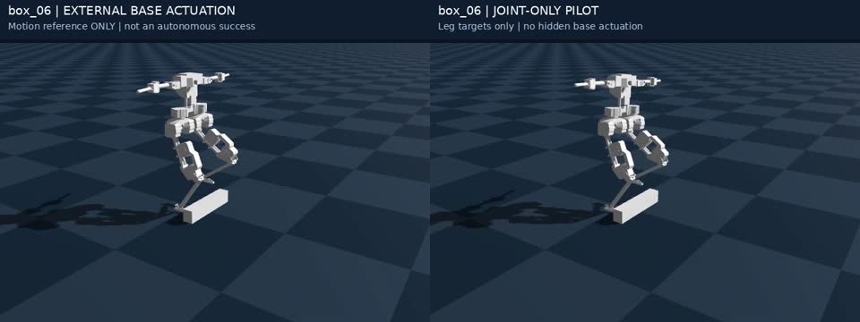
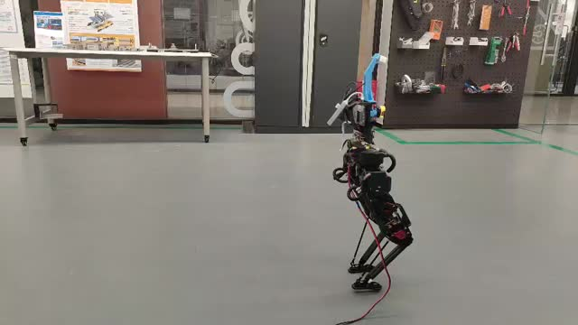
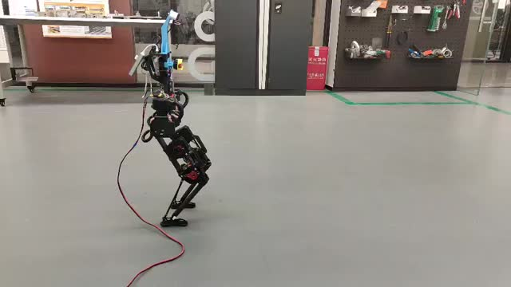
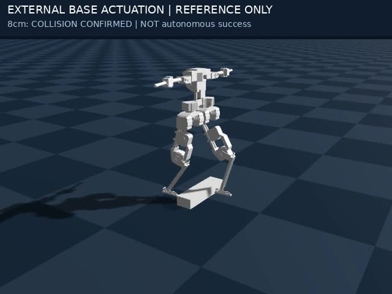
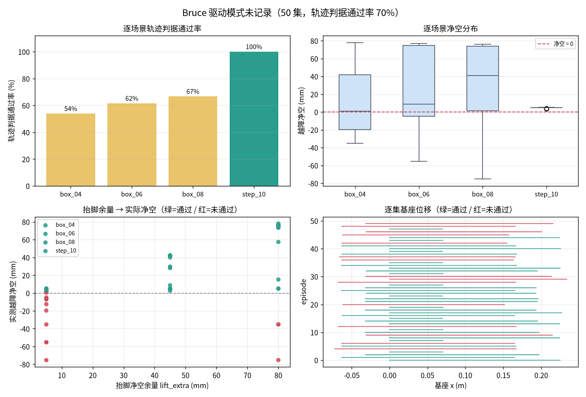

<div align="center">

# Bruce & H-JEPA in World Model

**面向人形机器人的世界模型：从 Genesis 仿真越障数据采集，到实机 IMU 运动估计**

[](LICENSE)
[](pyproject.toml)

</div>

<div align="center">
  
  <br/>
  <em>Genesis 仿真：基座辅助参考 vs 仅腿关节驱动先导测试</em>
</div>

---

## 这是什么

本仓库把三条工作线合并到一个可复现的代码库里：

1. **世界模型** —— 基于 [H-JEPA](https://github.com/kevinghst/H-JEPA) 的分层潜空间世界模型，提供 `stable_worldmodel` 的数据集契约、训练与规划链路。
2. **仿真数据** —— 用 [Genesis](https://github.com/Genesis-Embodied-AI/Genesis) 搭建 BRUCE 人形机器人的越障采集管线，产出可直接被 H-JEPA 读取的 HDF5。
3. **实机诊断** —— Khadas 侧的 BRUCE-OP 工具链：横移请求、反馈健康门禁、离线监督者测试。

核心取向是**零训练、纯内推演**：不依赖强化学习试错，而是把越障动作解算成可解析复现的轨迹，并对每一步做物理复核。

> **说明**：仓库的上游血统是 H-JEPA（见 [致谢与引用](#致谢与引用)）。本仓库保留了 H-JEPA 的训练/规划代码，并在其上叠加了 BRUCE 人形机器人的数据采集与实机工具链。

---

## 实机：IMU 前进 / 后退

BRUCE 实机基于 IMU 姿态估计进行前进与后退运动。以下为实拍视频（点击封面播放）：

<div align="center">
  <table>
    <tr>
      <td align="center">
        <a href="assets/videos/real_imu_forward.mp4">
          
        </a>
        <br/>
        <b>IMU 前进</b><br/>
        <sub>960×540 · 20.6 s · 30 fps</sub>
      </td>
      <td align="center">
        <a href="assets/videos/real_imu_backward.mp4">
          
        </a>
        <br/>
        <b>IMU 后退</b><br/>
        <sub>960×540 · 15.3 s · 29 fps</sub>
      </td>
    </tr>
  </table>
</div>

IMU 姿态 → 关节目标的换算链路在 [bruce_signals.py](scripts/data/bruce/bruce_signals.py) 中实现：比力按 `Rᵀ(a_world + [0,0,g])` 由加速度计真值反算，再叠加零偏与噪声模型；这与仿真采集使用的是同一套口径。

---

## 仿真：越障采集

<div align="center">
  <a href="BRUCE分场景视频/基座辅助_8cm障碍.mp4">
    
  </a>
  <br/>
  <em>8 cm 障碍越障（基座辅助，参考轨迹，非自主成功示范）</em>
</div>

`BRUCE分场景视频/` 下另有 4 cm / 6 cm / 8 cm 障碍与 10 cm 台阶、两种控制模式的完整视频：

| 视频 | 控制模式 | 说明 |
|---|---|---|
| `基座辅助_*.mp4` | `assisted` | 驱动浮动基座，适用于参考动作与采集接口演示 |
| `自由基座先导_*.mp4` | `joint_only` | 仅腿关节执行，先导测试，**不计入正式数据集** |

两种模式的语义**不可合并解释**：前者不代表实物可执行控制，后者才是实物口径。

### 快速开始

```bash
# 环境：Genesis 用 nudt，H-JEPA 检查用 hjepa
export PYOPENGL_PLATFORM=egl        # 无显示器环境

# 采集 50 集越障数据
~/miniconda3/envs/nudt/bin/python scripts/data/bruce/collect_bruce.py \
  --config scripts/data/bruce/config/bruce_stepover.yaml \
  --episodes 50 --out bruce_stepover_50

# 质检（110 项检查：结构 108 + 物理一致性 2，另有逐场景统计）
~/miniconda3/envs/hjepa/bin/python scripts/data/bruce/check_dataset.py \
  --dataset bruce_stepover_50

# 静态图表
~/miniconda3/envs/hjepa/bin/python scripts/data/bruce/make_figures.py \
  --dataset bruce_stepover_50

# 验证能被 H-JEPA 直接读取
~/miniconda3/envs/hjepa/bin/python scripts/data/bruce/verify_hjepa_read.py \
  --dataset bruce_stepover_50
```

一键脚本：

```bash
bash BRUCE仿真命令.sh help      # 查看全部子命令
bash BRUCE仿真命令.sh play       # 打开站立复核视频
bash BRUCE仿真命令.sh compare    # 打开仿真对比视频
bash BRUCE仿真命令.sh crossings  # 采集六种高度的越障尝试
```

### 采集结果

最近一批 50 集，17 500 帧 @ 100 Hz：

| 场景 | 集数 | 轨迹判据通过率 | 净空中位数 | 最小净空 | 踢箱 | 摔倒 |
|---|---|---|---|---|---|---|
| `box_04` | 13 | 53.8 % | 0.8 mm | −35.3 mm | 4 | 0 |
| `box_06` | 13 | 61.5 % | 8.7 mm | −55.3 mm | 5 | 0 |
| `box_08` | 12 | 66.7 % | 40.9 mm | −75.4 mm | 3 | 0 |
| `step_10` | 12 | 100 % | 5.0 mm | +3.8 mm | 0 | 0 |
| **合计** | **50** | **70.0 %** | **5.0 mm** | **−75.4 mm** | **12** | **0** |

<div align="center">
  
  <br/>
  <em>由 <code>make_figures.py</code> 从 <code>bruce_stepover_50.h5</code> 生成</em>
</div>

「轨迹判据通过率」是历史轨迹判据（净空 + 未踢箱 + 未摔倒），**不是自主成功**；同一批数据的自主成功数为 **0**（无任何一集同时满足关节力矩、基座未驱动、网格净空与落地稳定四项）。质检脚本把这两件事分开报告，退出码只反映采集结构是否合法。

关键规律：**抬脚余量 5 mm 时净空在 0 附近反复横跳（19 集里 9 集触箱），45 mm 时 14 集全为正，80 mm 时又偶发负净空**（抬脚过快导致 PD 控制滞后、撞到箱棱）。这说明越障成败对抬脚高度极其敏感，`lift_extra` 必须作为训练/评估时的显式条件。

另一个必须点明的落差：这批数据记录的腿关节**真值**控制力矩峰值达 40.0 N·m（左膝俯仰），有 1.6 % 的关节力矩样本超过 BRUCE-OP 硬件的 `TORQUE_MAX = 10.5 N·m`；而数据集里的 `joint_torque_est` 列按实物链路饱和在 ±10.5 N·m，**看不出这个超限**。即当前这批越障轨迹在关节出力上还不能直接下放实机。

### 采集管线

| 文件 | 职责 |
|---|---|
| [collect_bruce.py](scripts/data/bruce/collect_bruce.py) | 回合主循环：复位 → warm-up → 轨迹插值 → 100 Hz 记录 → 净空/踢箱/摔倒判定 |
| [bruce_env.py](scripts/data/bruce/bruce_env.py) | Genesis 场景封装：机器人/障碍构建、接触归属、足底力、踝关节坐标系 |
| [bruce_signals.py](scripts/data/bruce/bruce_signals.py) | 信号保真：列分类、力矩估计量化链、IMU 零偏模型 |
| [bruce_stepover.yaml](scripts/data/bruce/config/bruce_stepover.yaml) | 场景集合、DR 范围、输出布局 |
| [check_dataset.py](scripts/data/bruce/check_dataset.py) | 110 项检查（结构 108 + 物理一致性 2）+ 逐场景统计 |
| [make_figures.py](scripts/data/bruce/make_figures.py) | 静态图：轨迹 XZ、时序、数据集统计 |
| [verify_hjepa_read.py](scripts/data/bruce/verify_hjepa_read.py) | 经 `HDF5Dataset` 验证读入，检查无 `sim_*` 泄漏 |

**信号保真口径**（对齐 BRUCE-OP 实物链路）：

- `action` 为 10 维腿关节位置目标，右腿后左腿，每腿顺序为 yaw、pitch、roll、knee、ankle。
- 力矩估计链：真实力矩 → ÷0.35 得电流 → 电流按 0.0333 A/LSB 量化 → ×0.35 → 每关节固定 ±5 % 增益误差 → 饱和于 ±10.5 N·m。
- IMU 比力由加速度计真值经 `Rᵀ(a_world + [0,0,g])` 反算，配零偏与一阶滤波（w = 0.90）。
- 足底 4 路布尔顺序为 `[R_TOE, R_HEEL, L_TOE, L_HEEL]`。

字段按可信度分三类，`est_*` 为真值加噪声、`sim_*` 为仿真质检真值，**默认读取白名单排除**，不会被当作实机测量：

```
REAL_COLUMNS     # 有实物链路依据的仿真传感器代理
DERIVED_COLUMNS  # 由实机链路推导
SIM_COLUMNS      # 仿真真值
```

### 净空判据

与实机复核同款，几何量取自 URDF：

```
x_lo    = box_cx - hx - TOE(0.056)
x_hi    = box_cx + hx + HEEL(0.0385)
top     = h
clearance = min(ankle_z - SOLE(0.025) - top)
```

踢箱判据为位移 > 0.02 m 或 z 下沉 > 0.01 m；摔倒判据为 `min_base_z < 0.30`。

---

## 实机：横移诊断

`output/orange_approach_20261115/` 是 Khadas 侧的 BRUCE-OP 工具链：

| 文件 | 职责 |
|---|---|
| [run_lateral_bout.py](output/orange_approach_20261115/run_lateral_bout.py) | 有界横移试验的**观察 + 请求**客户端 |
| [lateral_feedback_health.py](output/orange_approach_20261115/lateral_feedback_health.py) | 反馈健康检查（电机码、时延、姿态矩阵、电压） |
| [lateral_tuning_trial.py](output/orange_approach_20261115/lateral_tuning_trial.py) | 横向偏置临时改写与安全回滚 |
| [stationary_sidestep_test.py](output/orange_approach_20261115/stationary_sidestep_test.py) | 站立监督者（唯一执行者） |

设计要点是**单一执行者原则**：本仓库的横移脚本只读共享内存、并在门禁通过后写一份 `step-request.json`，**从不打开电机接口**；实际动作全部由常驻监督者执行。

发请求前需同时满足：健康检查全绿 + 倾角 < 5° + 相位为 `holding_balance` + 状态 3 s 内新鲜 + 双脚都有触地，且**连续成立 3 秒**。观测期若倾角 > 8° 则写入 `operator-stop` 中止。

> 实机链路与仿真采集是两套独立口径，不可互相替代：仿真的力矩估计尚未经实机标定，实机横移的真实位移也需现场观察确认。

---

## 世界模型：H-JEPA

H-JEPA 学习分层的动作条件 JEPA 世界模型，每一层在各自的潜空间中预测更远的未来；规划时自顶向下逐级把预测转化为子目标。

在本仓库中，H-JEPA 承担三件事：

1. **数据契约** —— [stable_worldmodel/world.py](stable_worldmodel/world.py) 定义 HDF5 布局（`ep_offset` / `ep_len` / `ep_idx`、分块与 Blosc 压缩规则、SWMR 写入），Bruce 采集器严格复刻该契约。
2. **训练与规划** —— `h_jepa/` 下是模型与规划器实现，覆盖 AntMaze、FourRoom Distractors、OGBench Cube、Push-T 和 DROID 离线规划。
3. **读入验证** —— [verify_hjepa_read.py](scripts/data/bruce/verify_hjepa_read.py) 确认 Bruce 产出的数据集能经 `stable_worldmodel.data.dataset.HDF5Dataset` 正常读入，窗口数与 proprio 维度正确，且无 `sim_*` 列泄漏。

<a id="1-installation"></a>

### 安装

```bash
conda create -n hjepa python=3.11.13 && conda activate hjepa
pip install -e ".[train,env]" --extra-index-url https://download.pytorch.org/whl/cu128
export HJEPA_HOME=/path/to/data
```

模型与规划器配置见 [h_jepa/ARCHITECTURE.md](h_jepa/ARCHITECTURE.md) 与 `h_jepa/config/{train,eval}/`。

### 上游论文复现

以下小节保留 H-JEPA 原仓库的复现入口，指向 `docs/RESULTS.md` 中的论文参考值（**这些是论文报告值，不是本仓库的新测量结果**）。

#### 3.5) Depth comparison (Figure 6)

先完成 [训练](#安装)或下载预训练 checkpoint，并准备评估任务。训练时会自动跑该评估；要评估已保存的 checkpoint：

```bash
h_jepa/scripts/eval_depth.sh
```

结果写在 checkpoint 旁的 `eval_<planner>/metrics.yaml`。脚本支持 `ENVS` 与 `SEEDS` 过滤。参考值见 [docs/RESULTS.md](docs/RESULTS.md#depth-comparison-figure-6)。

#### 3.6) Cost ladder (Tables 1 and 9)

```bash
h_jepa/scripts/eval_cost_ladder.sh
```

结果写在 `eval_flat/metrics.yaml`（native L1）与 `eval_l<k>_project/metrics.yaml`（level-k cost）。参考值见 [docs/RESULTS.md](docs/RESULTS.md#cost-ladder-tables-1-and-9)。

#### 4.4) Planning evaluation

DROID 离线规划评估：

```bash
h_jepa/scripts/eval_droid.sh
```

结果写在 `eval_{flat,l2}/plan_seed<ps>/eval.csv`。参考值见 [docs/RESULTS.md](docs/RESULTS.md#droid-planning-figure-9b)。

---

## 仓库结构

```
bruce&H-JEPA in World Model/
├── scripts/data/bruce/        # Genesis 越障采集、信号保真、质检、绘图
│   └── config/bruce_stepover.yaml
├── scripts/data/split_cube.py # LeWM cube 数据集切分
├── h_jepa/                    # H-JEPA 训练与规划代码
├── stable_worldmodel/         # 世界模型基座与 HDF5 数据契约
├── output/                    # 各轮仿真与实机产出（视频、数据集、报告）
├── assets/videos/             # README 用视频与封面
├── BRUCE-OP-main/             # BRUCE-OP 上游代码
├── BRUCE仿真命令.sh            # 仿真一键脚本
└── BRUCE仿真说明.md            # 物理修正与验证说明
```

---

## 已知限制

- **仿真的越障成功不等于实物可执行**：`assisted` 模式驱动浮动基座，仅作参考；`joint_only` 才是实物口径，且当前 8 cm 越障仍未通过自主验证。
- **关节出力超出硬件上限**：50 集中腿关节真值控制力矩峰值 40.0 N·m，1.6 % 的样本超过 `TORQUE_MAX = 10.5 N·m`，这批轨迹尚不能直接下放实机。
- **自主成功数为 0**：历史 `success` 标记只是轨迹判据（净空 + 未踢箱 + 未摔倒），不构成自主越障成功。
- **噪声与量化参数未经实机标定**：力矩换算依赖 `IQ2TORQUE = 0.35` 与 ±5 % 增益误差假设。
- **两个 139 MB 的 checkpoint 未入库**：超过 GitHub 单文件 100 MB 上限，保留在本地（见 `.gitignore`）。
- **实机闭环尚未完成**：`output/orange_approach_20261115/` 记录的硬件侧因传感器时延问题停机，电机保持关闭使能。

---

## 致谢与引用

本仓库的上游是 **H-JEPA**，其论文与代码版权归原作者所有：

```bibtex
@article{zhang2026hjepa,
  title   = {{H-JEPA}: End-to-End Learning of Hierarchical World Models for Visual Planning},
  author  = {Zhang, Wancong and Terver, Basile and Rabbat, Mike and LeCun, Yann and Balestriero, Randall},
  journal = {arXiv preprint arXiv:2610.06805},
  year    = {2026}
}
```

- H-JEPA: https://github.com/kevinghst/H-JEPA
- LeWM: https://github.com/lucas-maes/le-wm
- stable-worldmodel: https://github.com/galilai-group/stable-worldmodel
- Genesis: https://github.com/Genesis-Embodied-AI/Genesis

本仓库新增的 BRUCE 人形机器人采集与诊断代码，遵循 MIT 协议（见 [LICENSE](LICENSE)）。
