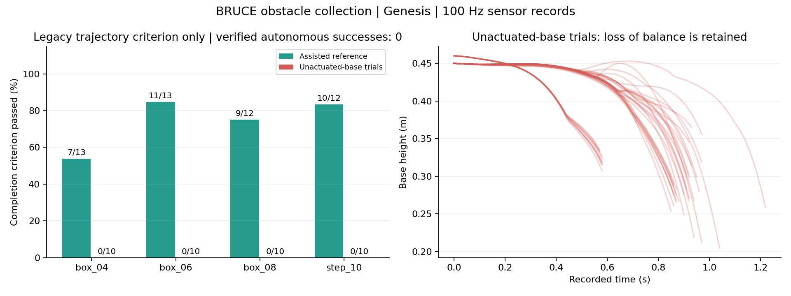

# BRUCE 仿真越障采集报告

> **真实性复核更正：辅助模式含不可部署的基座驱动力；“37 条通过判据”不是可信的自主越障成功。当前可直接训练视觉 H-JEPA 的合格数据为 0 条。详见 [8 cm 真实性复核](8cm真实性复核.md)。**

> 后续物理修正见 [当前仿真说明](../../BRUCE仿真说明.md)。本目录两份历史 HDF5 未修改；下面的通过数量均为历史参考轨迹判据。当前检查器另外给出自主成功资格，数量为 0。当前源代码已更新，旧 `manifest.json` 保留的是更新前快照，不能当作当前源码哈希。

日期：2026-11-13。平台：本机 Genesis 1.4.4 / RTX 3060。此次完成采集程序修复、仿真记录、数据质检和可视化交付；**自由基座的成功越障控制尚未解决**。

## 结果与用途

正式交付两份独立数据，不能合并计算成功率：

| 数据 | 集数 | 帧数 | 记录时长 | 当前判据通过 | 用途 |
|---|---:|---:|---:|---:|---|
| 基座辅助参考 | 50 | 17500 | 175.00 s | 37/50 | 参考动作、传感器接口与越障呈现 |
| 自由基座尝试 | 40 | 3386 | 33.86 s | 0/40 | 无基座驱动力的实际仿真转移与失败样本 |

| 场景 | 基座辅助参考通过/总数 | 自由基座通过/总数 |
|---|---:|---:|
| box_04 | 7/13 | 0/10 |
| box_06 | 11/13 | 0/10 |
| box_08 | 9/12 | 0/10 |
| step_10 | 10/12 | 0/10 |

辅助模式给基座施加位置伺服，而策略动作仅包含腿部关节，因此不能将其视为由 10 维腿部动作完整决定的实物转移数据。当前保留 `sim_reference` 和 `sim_control_force` 来暴露辅助控制。自由基座模式禁用基座伺服并限制真实执行的腿关节力矩；40 集均失衡，未筛掉这些失败。

## 先看呈现

- [对比视频](presentation/comparison.mp4)：左侧为辅助参考；右侧为独立的 4 条自由基座先导测试，视频标为 PILOT，失败结束后保持末帧。先导测试不计入上表正式 40 集。
- [逐场景关键帧](presentation/contact_sheet.png)。
- [采集总览](presentation/overview.png)。
- [辅助参考轨迹剖面](assisted_figures/traj_xz.png)、[传感器曲线](assisted_figures/timeseries.png)、[辅助参考统计](assisted_figures/dataset_stats.png)。
- [自由基座轨迹](joint_figures/traj_xz.png)、[自由基座传感器曲线](joint_figures/timeseries.png)。



## 数据文件

- [辅助参考 HDF5](bruce_assisted_reference_50.h5) 与 [逐集元数据](bruce_assisted_reference_50.meta.jsonl)。
- [自由基座 HDF5](bruce_joint_trials_40.h5) 与 [逐集元数据](bruce_joint_trials_40.meta.jsonl)。
- [辅助配置](assisted_config.yaml)、[自由基座配置](joint_config.yaml)。
- [辅助数据质检](bruce_assisted_reference_50.report.json)、[自由基座数据质检](bruce_joint_trials_40.report.json)。

HDF5 使用连续帧轴和 `ep_len/ep_offset/ep_idx/step_idx` 索引。传感器记录频率 100 Hz，仿真步长 0.5 ms，每记录周期执行 20 个物理步。视频 25 fps，是呈现材料，不是 HDF5 里的逐帧视觉输入。`timestamp` 为仿真时间而非墙钟时间。

`action[t]` 是观察 `o_t` 后下发、在随后 10 ms 保持的腿部位置目标。第 t 行的受力和状态是该观测时刻的值；受力不是下发新目标后立即测得的响应。最后一行动作不再错误地回绕到首帧。

## 实物可采集字段的判断

下表依据当前 BRUCE-OP 源码，而非假设机器人拥有外部定位、相机或足底力传感器。

| 字段 | 实物依据与性质 | 本次仿真实现 |
|---|---|---|
| `action`，10 维 rad | `Startups/run_bear.py:221` 支持关节位置命令，通过 `joint2bear` 转换为电机目标 | 记录实际保持的腿部关节目标 |
| `leg_q/leg_dq`，各 10 维 | `run_bear.py:225,254-262` 读取 position/velocity 并滤波、机构换算 | 关节真值量化和低通代理 |
| `imu_acc/imu_gyro`，各 3 维 | `Library/BRUCE_SENSE/Manager.py:83-88` 解包加速度、角速度 | 世界系加速度转机体系比力，叠加配置噪声 |
| `foot_contact`，4 维布尔 | `Manager.py:89-90` 解包四路开关；顺序 R_TOE、R_HEEL、L_TOE、L_HEEL | 仿真接触力阈值化，不能当作实物可读法向力 |
| `joint_torque_est`，10 维 N·m | `run_bear.py:225,256,263-264` 读取电流并进行机构换算；`BRUCE_macros.py:318,325,331` 给出换算和上限常量 | 仿真力矩经简化电流/量化/增益误差模型得到的代理，不是力矩传感器测量 |
| `est_body_pos/vel/acc/yaw` | `Settings/BRUCE_data.py:57-62` 消费状态估计器输出；属于估计，非直接测量 | 本轮仅为真值加噪声，未运行 BRUCE 的 EKF，默认白名单排除 |
| `sim_body_* / sim_base_quat / sim_contact_force / sim_joint_torque / sim_ankle_pos` 等 | 精确世界位姿、接触力、执行力矩和足部轨迹属于仿真真值 | 仅用于质检与呈现，默认白名单排除 |

噪声幅值、量化步长、足底力阈值和估计误差幅值均未做实机标定。EKF 中的噪声协方差不能直接解释成传感器标准差。这里验证的是“有实物读取链路的字段”，不是仿真传感器与实机统计已经一致。

## 通过了哪些检查

两份正式数据结构与记录一致性检查均通过，包含列长度/形状、有限值、episode 索引、时间间隔、足底布尔代理、动作与实际保持目标的一致性、IMU 坐标变换。自由基座数据额外通过基座执行力为零与腿关节 ±10.5 N·m 执行限幅检查。**质检通过不代表越障成功**。

[4 项回归测试](collection_tests.log)检查写入列对齐、中断尾部截断、缺失测量的 JSON 表示以及 IMU/动作/接触变换。[HDF5 读取检查](hdf5_reader_check.log)通过，读取白名单排除了 `sim_*` 和本轮伪估计的 `est_*`。

[H-JEPA 运行检查](hjepa_runtime.json)覆盖 AntMaze 三层 H-JEPA、三层 HWM 和 DROID 两层 H-JEPA：模型构造、损失、反向传播、规划动作梯度、保存加载。AntMaze 还执行了实际分层求解器，并覆盖高层跳过的尾段。DROID 检查将输入缩为 64×64 以控制本机内存；这不是完整 256×256、多卡训练验证。

[真实训练入口日志](training_entry_smoke.log)记录了 AntMaze 三层模型在独立合成夹具上的一次训练和验证。合成夹具在 `runtime_fixture/`，与 BRUCE 数据完全分开；没有用 BRUCE 数据训练 H-JEPA，也没有复现论文成功率。

## 修复范围与仍然存在的限制

修复了 HJEPA 构造时 `japas` 拼写错误，以及单步调试下 warmup 与总步数相等造成的调度器除零。清理了训练入口、模型组织与损失装配三份核心文件中逐行翻译式的中文注释，保留必要的时间、坐标和动作语义说明。

采集器明确区分驱动模式、限制正式模式执行力矩，采用记录周期目标保持，修复末行动作回绕，加入时间戳、配置和辅助受力记录。写入器验证列长度，保存完整 episode 的提交数量，续采时截去未提交尾部。

越障完成判据要求：状态有限、未明显移箱、未跌倒、双脚达到障碍另一侧/平台，以及正的踝轨迹净空代理。净空来自 200 Hz 踝原点轨迹减去固定足底偏移，不是完整脚部网格距离；它不是严格的全身无碰撞证明。仿真采用 Genesis 的 URDF 碰撞处理，不能宣称与原 Gazebo 接触动力学相同。

额外尝试了慢速 COM/IK 与逆动力学控制参考，先导测试仍失衡，未纳入正式数据或默认采集器。实验草稿与视频存于 `experiments/` 及对应 probe 文件；不作为已验证控制器交付。

因此，本轮交付的是**可审查的仿真采集记录与明确标注的参考动作**。如果目标是实物动作可执行的成功越障训练集，仍需完成自由基座稳定控制，再重新采集成功样本。当前 HDF5 也没有 pixels，不能直接当作现成视觉 H-JEPA 训练数据。

## 复现

仓库根目录执行。下面使用新目录，避免与本轮数据混用：

```bash
PYOPENGL_PLATFORM=egl /home/user/miniconda3/envs/nudt/bin/python scripts/data/bruce/collect_bruce.py \
  --config scripts/data/bruce/config/bruce_stepover.yaml --control-mode joint_only \
  --episodes 40 --out bruce_joint_trials --cache-dir output/bruce_rerun

PYOPENGL_PLATFORM=egl /home/user/miniconda3/envs/nudt/bin/python scripts/data/bruce/collect_bruce.py \
  --config scripts/data/bruce/config/bruce_stepover.yaml --control-mode assisted \
  --episodes 50 --out bruce_assisted_reference --cache-dir output/bruce_rerun \
  --video-dir output/bruce_rerun/videos --video-episodes 4

/home/user/miniconda3/envs/nudt/bin/python scripts/data/bruce/test_collection.py
/home/user/miniconda3/envs/hjepa/bin/python scripts/check_hjepa_runtime.py
/home/user/miniconda3/envs/hjepa/bin/python scripts/check_hjepa_entry.py
```

如需图表，用 `make_figures.py --dataset <名称> --cache-dir <目录> --outdir <图目录>`。本轮视频编排可由 `present_collection.py output/bruce_sim_20261113` 重建。
